# CineConnect — Complete Project Progress Audit & Technical Status Report

**Report Date**: November 18, 2026  
**Auditor**: Antigravity DeepMind Engineering Agent  
**Audit Mode**: Strictly READ-ONLY (Zero mutations, zero schema changes, zero commits)  
**Target Repository**: `D:\CineConnect`  
**Active Git Branch**: `backend/sajid`  
**Document Location**: `D:\CineConnect\docs\reports\CineConnect_Complete_Project_Status_Report.md`

---

## 1. Executive Summary

CineConnect is an asynchronous digital platform bridging Indian film industry **Talent** (actors, crew, writers, directors, technicians) with **Production Houses** (studios, casting directors, producers) for casting, production management, project collaboration, networking, media showcasing, and real-time messaging.

This comprehensive technical audit evaluated the current state of the repository, including:
1. **FastAPI Backend**: Fully structured asynchronous REST and WebSocket API consisting of **95 registered HTTP endpoints** and **1 real-time WebSocket endpoint** across 16 route modules.
2. **PostgreSQL Database**: Single-source-of-truth PostgreSQL 16 instance hosted in Docker with **11 approved application tables** on active Alembic revision `40a120ca0017`.
3. **Database Test Isolation**: Fully operational `cineconnect_test_db` running on port 5433 with transaction savepoint rollbacks; both development and test databases verified at **0 residual test records**.
4. **Automated Testing Suite**: **186 automated integration tests** covering all 15 business domains; **185 passed, 1 skipped, 0 failed** in **23.40 seconds**.
5. **Supabase Authentication**: Pure cryptographic verification of HS256 JWTs with JIT (Just-In-Time) user synchronization and Role-Based Access Control (RBAC).
6. **Flutter Mobile Application**: Foundation-level architecture implementing dark theme design tokens, environment configurations, and health diagnostics, with full feature screens and Supabase client integration currently pending.

---

## 2. Actual Project Architecture

### 2.1 Repository Directory Structure

```
D:\CineConnect\
├── .env                              # Active environment configuration (local secrets)
├── .env.example                      # Sanitized environment template
├── .gitignore                        # Git exclusion rules
├── CONTRIBUTING.md                   # Collaboration and Git flow standards
├── README.md                         # Main project documentation
├── backend/                          # FastAPI Python asynchronous service
│   ├── Dockerfile                    # Multi-stage non-root container image definition
│   ├── requirements.txt              # Pinned Python package dependencies
│   ├── pytest.ini                    # Pytest configuration (asyncio mode = auto)
│   ├── alembic.ini                   # Alembic database migration configuration
│   ├── alembic/                      # Database migrations
│   │   ├── env.py                    # Migration execution script (dual DB aware)
│   │   ├── versions/                 # Active migrations (40a120ca0017)
│   │   └── legacy_archive/           # Archived previous migration iterations
│   ├── app/                          # Core application package
│   │   ├── main.py                   # FastAPI initialization, lifespan, middleware
│   │   ├── api/                      # Routing and dependencies
│   │   │   ├── dependencies.py       # Supabase JWT authentication & RBAC guards
│   │   │   ├── websocket.py          # WebSocket connection manager & chat handler
│   │   │   └── v1/
│   │   │       ├── api.py            # API v1 consolidated APIRouter
│   │   │       └── endpoints/        # 16 domain endpoint modules
│   │   ├── core/                     # Configuration, logging, security
│   │   ├── db/                       # Database engine, session maker, init logic
│   │   ├── models/                   # 11 SQLAlchemy 2.0 ORM domain models
│   │   ├── schemas/                  # Pydantic v2 validation and response models
│   │   ├── repositories/             # Interface placeholders for DAL (currently empty)
│   │   ├── services/                 # Interface placeholders for business logic (currently empty)
│   │   └── utils/                    # Shared helper utilities
│   └── tests/                        # Comprehensive automated test suite
│       ├── conftest.py               # Asynchronous fixtures, test DB, canonical JWTs
│       └── api/                      # 16 domain integration test modules (186 tests)
├── backups/                          # Offline schema and database dumps
├── docs/                             # Architecture and API documentation
│   ├── api-guidelines.md
│   ├── architecture.md
│   ├── database-design.md
│   ├── development-setup.md
│   └── reports/                      # Progress and audit reports
├── infrastructure/                   # Docker Compose and container infrastructure
│   ├── docker-compose.yml            # Multi-container orchestration (postgres, backend)
│   ├── .env                          # Infrastructure environment variables
│   └── docker/                       # Container init scripts and configs
└── mobile/                           # Cross-platform Flutter mobile client
    ├── pubspec.yaml                  # Dart/Flutter dependencies
    ├── analysis_options.yaml         # Linter rules
    ├── android/                      # Native Android project configuration
    ├── ios/                          # Native iOS project configuration
    ├── assets/                       # Static fonts, icons, images, animations
    └── lib/                          # Application source code
        ├── main.dart                 # Application entrypoint
        ├── app/                      # Theme, typography, and routing
        ├── core/                     # Network clients, config, error models
        ├── features/                 # Feature modules (home screen diagnostic)
        └── shared/                   # Shared UI buttons and health services
```

### 2.2 Technology Stack

| Layer | Technology | Version | Purpose |
|---|---|---|---|
| **API Framework** | FastAPI | 0.115.5 | Asynchronous REST and WebSocket routing |
| **ASGI Server** | Uvicorn | 0.32.0 | High-performance async runtime |
| **Runtime** | Python | 3.12.10 | Backend execution environment |
| **ORM** | SQLAlchemy | 2.0.36 | Async relational mapping via `asyncpg` |
| **Driver** | asyncpg | 0.30.0 | High-speed binary PostgreSQL async driver |
| **Migrations** | Alembic | 1.14.0 | Schema revision management |
| **Validation** | Pydantic v2 | 2.10.1 | Data serialization and request parsing |
| **Testing** | Pytest + pytest-asyncio | 8.3.3 / 0.24.0 | Automated asynchronous integration testing |
| **Database** | PostgreSQL | 16.16 (Alpine) | Primary relational database |
| **Auth** | Supabase Auth (HS256) | Cloud/JWT | Identity management and token generation |
| **Mobile Client** | Flutter / Dart | 3.x / ^3.13.5 | Cross-platform iOS/Android mobile client |
| **Storage (Target)** | MinIO / AWS S3 | Cloud/Object | Media, showreels, documents (planned/presigned) |
| **Cache (Target)** | Redis | 7.x | Caching, session state, real-time fanout (configured in code) |

### 2.3 Layer Responsibilities

- **Frontend (Mobile)**: Responsible for rendering UI components, capturing user inputs, managing client state, and communicating with backend REST endpoints and WebSocket chat.
- **Backend (FastAPI)**: Responsible for routing, payload validation, RBAC enforcement, query execution, business logic evaluation, presigned storage URL generation, and WebSocket distribution.
- **Authentication (Supabase)**: Authoritative identity provider generating signed JWTs with custom user metadata.
- **Database (PostgreSQL)**: Relational data store enforcing foreign key integrity, cascade rules, and persistence across 11 core tables.
- **Media Storage (MinIO / S3)**: Direct-to-storage upload target using backend-issued HMAC-signed presigned URLs.
- **Cache (Redis)**: Planned for conversation caching and pub/sub message distribution across multiple backend instances.

---

## 3. Git and Development Status

```
Repository Root: D:\CineConnect
Remote URL: https://github.com/sajid830/CineConnect.git
Active Branch: backend/sajid
Tracking Branch: origin/backend/sajid
```

### 3.1 Branch Inventory
- `* backend/sajid` (active working branch)
- `main`
- `remotes/origin/backend/sajid`
- `remotes/origin/main`

### 3.2 Commit History
- `0ff4246`: `feat: implement backend API structure, database models, and infrastructure setup`
- `77bf3df`: `feat: initialize project structure and backend virtual environment`

### 3.3 Working Tree Status (Uncommitted Changes)
The repository contains uncommitted modifications reflecting the backend refactoring, Alembic baseline reset, model synchronization, and Phase 10 test implementation:

#### Modified Files:
1. `.env.example`: Updated environment template for isolated test database credentials.
2. `backend/alembic/env.py`: Dynamic database URL switching supporting test runner (`-x db=test`).
3. `backend/app/core/config.py`: Added `POSTGRES_TEST_DB` and `async_test_database_url` properties.
4. `backend/app/db/init_db.py`: Updated connection check logic.
5. `backend/app/models/__init__.py`: Registered canonical 11 domain models.
6. `backend/app/models/message.py`: Cleaned relationship references.
7. `backend/app/models/notification.py`: Decoupled reverse relationship to `User`.
8. `backend/app/models/opportunity.py`: Synced application back-references.
9. `backend/app/models/portfolio.py`: Synced portfolio model.
10. `backend/app/models/production_house.py`: Synced project and opportunity relationships.
11. `backend/app/models/social.py`: Aligned connection and collaboration relationships.
12. `backend/app/models/user.py`: Synced account types and relations.
13. `backend/tests/conftest.py`: Updated pytest fixtures for PostgreSQL test database isolation.

#### Deleted Files:
- `backend/alembic/versions/2026_11_16_1550-b46d376abd57_create_cineconnect_schema.py` (archived to legacy backup).

#### Untracked Directories & Files:
- `backend/alembic/legacy_archive/`
- `backend/alembic/versions/2026_11_17_1644-40a120ca0017_create_cineconnect_schema.py` (Active Baseline Migration)
- `backend/tests/api/` (Complete integration test suite across 16 domain files)
- `backups/legacy_migrations/`

---

## 4. Backend Implementation Audit

### 4.1 Application Initialization & Lifespan
- **File**: `backend/app/main.py`
- **Lifespan Manager**: `asynccontextmanager` executes startup logging, environment validation, and calls `init_db()` to verify database connectivity.
- **Middleware**: `CORSMiddleware` configured with origins from `settings.CORS_ORIGINS` supporting credentials, `GET`, `POST`, `PUT`, `DELETE`, `PATCH`, and `OPTIONS`.
- **Exception Handlers**:
  - `StarletteHTTPException`: Standardizes JSON response format (`status`, `code`, `detail`).
  - `RequestValidationError`: Returns structured 422 errors containing detailed field-level validation messages.
  - `Exception`: Global catch-all handler returning 500 JSON without leaking system stack traces.

### 4.2 Database Session Management
- **File**: `backend/app/db/session.py`
- Uses `create_async_engine` with `asyncpg`.
- Session factory `AsyncSessionLocal` configured with `expire_on_commit=False`.
- Dependency generator `get_db()` provides an isolated `AsyncSession` per request.

### 4.3 Architecture Layers: Repositories & Services
- **Status**: Currently **NOT decoupled**.
- `backend/app/repositories/` contains only `__init__.py`.
- `backend/app/services/` contains only `__init__.py`.
- **Finding**: All business logic, queries, status mutations, and validations are currently implemented directly inside the route functions under `backend/app/api/v1/endpoints/`.

### 4.4 Real-Time WebSocket Implementation
- **File**: `backend/app/api/websocket.py`
- **Endpoint**: `/ws/chat?token=<jwt>`
- **Connection Manager**: `ConnectionManager` maintains in-memory mapping `Dict[UUID, List[WebSocket]]`.
- **Features**: Token verification on handshake, connection acknowledgment, ping/pong keepalive, database persistence of chat messages, echo to sender, and real-time delivery to active recipient connections.

---

## 5. Complete API Inventory

The FastAPI application has **95 registered HTTP endpoints** and **1 WebSocket endpoint**, totaling **96 application endpoints** (100 total routes including OpenAPI documentation).

### Summary by Domain
1. **Health & System**: 3 endpoints
2. **Authentication & Users**: 11 endpoints
3. **Production Houses**: 8 endpoints
4. **Projects**: 10 endpoints
5. **Opportunities**: 10 endpoints
6. **Applications**: 7 endpoints
7. **Portfolio Media**: 5 endpoints
8. **Social Posts**: 8 endpoints
9. **Interactions**: 5 endpoints
10. **Connections**: 7 endpoints
11. **Collaborations**: 7 endpoints
12. **Messages**: 6 endpoints
13. **Search & Discovery**: 1 endpoint
14. **Notifications**: 4 endpoints *(Unavailable DB Table)*
15. **Media Storage**: 1 endpoint
16. **Dashboards**: 2 endpoints *(1 Partially Defective)*
17. **WebSocket**: 1 endpoint

---

### Detailed Inventory Table

| # | Domain | Endpoint | Method | Purpose | Authentication | Status |
|---|---|---|:---:|---|---|:---:|
| 1 | Health | `/health` | GET | Root health check | None | Operational |
| 2 | Health | `/api/v1/health` | GET | Detailed API runtime metadata | None | Operational |
| 3 | Health | `/api/v1/health/db` | GET | Live PostgreSQL latency probe | None | Operational |
| 4 | Users | `/api/v1/users/me` | GET | Retrieve authenticated profile | `get_current_user` | Operational |
| 5 | Users | `/api/v1/users/me` | PUT | Full profile update | `get_current_user` | Operational |
| 6 | Users | `/api/v1/users/me` | PATCH | Partial profile update | `get_current_user` | Operational |
| 7 | Users | `/api/v1/users/search` | GET | Search talent by name, role, city | None | Operational |
| 8 | Users | `/api/v1/users/{user_id}` | GET | Public profile view by ID | None | Operational |
| 9 | Users | `/api/v1/users` | GET | Paginated user listing | None | Operational |
| 10 | Users | `/api/v1/users/{user_id}/portfolio` | GET | Public user portfolio listing | None | Operational |
| 11 | Users | `/api/v1/users/{user_id}/posts` | GET | Public user posts listing | None | Operational |
| 12 | Users | `/api/v1/users/{user_id}/connections` | GET | User accepted connections list | None | Operational |
| 13 | Users | `/api/v1/users/{user_id}/followers` | GET | User followers list | None | Operational |
| 14 | Users | `/api/v1/users/{user_id}/following` | GET | User following list | None | Operational |
| 15 | Production Houses | `/api/v1/production-houses` | POST | Create studio profile | `get_current_user` | Operational |
| 16 | Production Houses | `/api/v1/production-houses/me` | GET | Get current studio profile | `require_production_house` | Operational |
| 17 | Production Houses | `/api/v1/production-houses/me` | PUT | Update studio profile | `require_production_house` | Operational |
| 18 | Production Houses | `/api/v1/production-houses/search` | GET | Search studios by name/location | None | Operational |
| 19 | Production Houses | `/api/v1/production-houses/{house_id}` | GET | View studio profile details | None | Operational |
| 20 | Production Houses | `/api/v1/production-houses` | GET | List production houses | None | Operational |
| 21 | Production Houses | `/api/v1/production-houses/{house_id}/projects` | GET | Studio projects list | None | Operational |
| 22 | Production Houses | `/api/v1/production-houses/{house_id}/opportunities` | GET | Studio opportunities list | None | Operational |
| 23 | Projects | `/api/v1/projects` | POST | Create project under studio | `require_production_house` | Operational |
| 24 | Projects | `/api/v1/projects/my` | GET | List own studio projects | `require_production_house` | Operational |
| 25 | Projects | `/api/v1/projects/search` | GET | Search projects by genre/status | None | Operational |
| 26 | Projects | `/api/v1/projects/{project_id}` | GET | Get project details by ID | None | Operational |
| 27 | Projects | `/api/v1/projects/{project_id}` | PUT | Complete project update | `require_production_house` | Operational |
| 28 | Projects | `/api/v1/projects/{project_id}` | PATCH | Partial project update | `require_production_house` | Operational |
| 29 | Projects | `/api/v1/projects/{project_id}` | DELETE | Hard delete project | `require_production_house` | Operational |
| 30 | Projects | `/api/v1/projects` | GET | List all public projects | None | Operational |
| 31 | Projects | `/api/v1/projects/{project_id}/opportunities` | GET | List project opportunities | None | Operational |
| 32 | Projects | `/api/v1/projects/{project_id}/collaborations` | GET | List project collaborations | None | Operational |
| 33 | Opportunities | `/api/v1/opportunities/` | POST | Create casting opportunity | `require_production_house` | Operational |
| 34 | Opportunities | `/api/v1/opportunities/my` | GET | List own studio opportunities | `require_production_house` | Operational |
| 35 | Opportunities | `/api/v1/opportunities/search` | GET | Search opportunities | None | Operational |
| 36 | Opportunities | `/api/v1/opportunities/` | GET | List all opportunities | None | Operational |
| 37 | Opportunities | `/api/v1/opportunities/{opportunity_id}` | GET | View opportunity details | None | Operational |
| 38 | Opportunities | `/api/v1/opportunities/{opportunity_id}` | PUT | Update opportunity | `require_production_house` | Operational |
| 39 | Opportunities | `/api/v1/opportunities/{opportunity_id}` | PATCH | Partial update opportunity | `require_production_house` | Operational |
| 40 | Opportunities | `/api/v1/opportunities/{opportunity_id}` | DELETE | Delete opportunity | `require_production_house` | Operational |
| 41 | Opportunities | `/api/v1/opportunities/{opportunity_id}/applications` | GET | List candidate applications | `require_production_house` | Operational |
| 42 | Opportunities | `/api/v1/opportunities/{opportunity_id}/status` | PATCH | Update opportunity status | `require_production_house` | Operational |
| 43 | Applications | `/api/v1/applications/` | POST | Apply to open opportunity | `require_talent` | Operational |
| 44 | Applications | `/api/v1/applications/my` | GET | List talent's submitted apps | `require_talent` | Operational |
| 45 | Applications | `/api/v1/applications/` | GET | List studio received apps | `require_production_house` | Operational |
| 46 | Applications | `/api/v1/applications/{application_id}` | GET | View application details | `get_current_user` | Operational |
| 47 | Applications | `/api/v1/applications/{application_id}` | PATCH | Update application notes/reels | `require_talent` | Operational |
| 48 | Applications | `/api/v1/applications/{application_id}` | DELETE | Withdraw application | `require_talent` | Operational |
| 49 | Applications | `/api/v1/applications/{application_id}/status` | PATCH | Review/update app status | `require_production_house` | Operational |
| 50 | Portfolio Media | `/api/v1/portfolio/` | POST | Add talent portfolio item | `require_talent` | Operational |
| 51 | Portfolio Media | `/api/v1/portfolio/my` | GET | List own portfolio media | `require_talent` | Operational |
| 52 | Portfolio Media | `/api/v1/portfolio/{media_id}` | GET | Get portfolio item details | None | Operational |
| 53 | Portfolio Media | `/api/v1/portfolio/{media_id}` | PUT | Update portfolio item | `require_talent` | Operational |
| 54 | Portfolio Media | `/api/v1/portfolio/{media_id}` | DELETE | Delete portfolio item | `require_talent` | Operational |
| 55 | Social Posts | `/api/v1/posts/` | POST | Create feed post | `get_current_user` | Operational |
| 56 | Social Posts | `/api/v1/posts/my` | GET | List own posts | `get_current_user` | Operational |
| 57 | Social Posts | `/api/v1/posts/` | GET | Public timeline feed | None | Operational |
| 58 | Social Posts | `/api/v1/posts/{post_id}` | GET | View single post by ID | None | Operational |
| 59 | Social Posts | `/api/v1/posts/{post_id}` | PUT | Update post caption/media | `get_current_user` | Operational |
| 60 | Social Posts | `/api/v1/posts/{post_id}` | DELETE | Delete post | `get_current_user` | Operational |
| 61 | Social Posts | `/api/v1/posts/{post_id}/interactions` | GET | List post comments/likes | None | Operational |
| 62 | Social Posts | `/api/v1/posts/{post_id}/interactions` | POST | Add interaction via subroute | `get_current_user` | Operational |
| 63 | Interactions | `/api/v1/interactions/` | POST | Like or comment on post | `get_current_user` | Operational |
| 64 | Interactions | `/api/v1/interactions/my` | GET | List user's interactions | `get_current_user` | Operational |
| 65 | Interactions | `/api/v1/interactions/{interaction_id}` | GET | Get interaction by ID | None | Operational |
| 66 | Interactions | `/api/v1/interactions/{interaction_id}` | PATCH | Edit comment body | `get_current_user` | Operational |
| 67 | Interactions | `/api/v1/interactions/{interaction_id}` | DELETE | Delete comment or unlike | `get_current_user` | Operational |
| 68 | Connections | `/api/v1/connections/` | POST | Send connection request | `get_current_user` | Operational |
| 69 | Connections | `/api/v1/connections/my` | GET | List accepted connections | `get_current_user` | Operational |
| 70 | Connections | `/api/v1/connections/requests` | GET | List pending received requests | `get_current_user` | Operational |
| 71 | Connections | `/api/v1/connections/{connection_id}` | GET | Get connection details | `get_current_user` | Operational |
| 72 | Connections | `/api/v1/connections/{connection_id}/accept` | PATCH | Accept connection request | `get_current_user` | Operational |
| 73 | Connections | `/api/v1/connections/{connection_id}/reject` | PATCH | Reject connection request | `get_current_user` | Operational |
| 74 | Connections | `/api/v1/connections/{connection_id}` | DELETE | Disconnect / cancel request | `get_current_user` | Operational |
| 75 | Collaborations | `/api/v1/collaborations/` | POST | Invite talent to project | `require_production_house` | Operational |
| 76 | Collaborations | `/api/v1/collaborations/my` | GET | List user's collaborations | `get_current_user` | Operational |
| 77 | Collaborations | `/api/v1/collaborations/{collaboration_id}` | GET | Get collaboration details | `get_current_user` | Operational |
| 78 | Collaborations | `/api/v1/collaborations/{collaboration_id}/accept` | PATCH | Accept invitation | `require_talent` | Operational |
| 79 | Collaborations | `/api/v1/collaborations/{collaboration_id}/reject` | PATCH | Reject invitation | `require_talent` | Operational |
| 80 | Collaborations | `/api/v1/collaborations/{collaboration_id}/status` | PATCH | Update collaboration status | `require_production_house` | Operational |
| 81 | Collaborations | `/api/v1/collaborations/{collaboration_id}` | DELETE | Delete collaboration | `get_current_user` | Operational |
| 82 | Messages | `/api/v1/messages/` | POST | Send direct message | `get_current_user` | Operational |
| 83 | Messages | `/api/v1/messages/conversations` | GET | Conversation summaries | `get_current_user` | Operational |
| 84 | Messages | `/api/v1/messages/conversations/{user_id}` | GET | Thread history & read mark | `get_current_user` | Operational |
| 85 | Messages | `/api/v1/messages/unread-count` | GET | Total unread message count | `get_current_user` | Operational |
| 86 | Messages | `/api/v1/messages/{message_id}` | GET | Get message by ID | `get_current_user` | Operational |
| 87 | Messages | `/api/v1/messages/{message_id}` | DELETE | Delete message | `get_current_user` | Operational |
| 88 | Search | `/api/v1/search/` | GET | Unified global search | None | Operational |
| 89 | Notifications | `/api/v1/notifications/` | GET | List notifications | `get_current_user` | **Fails (No DB Table)** |
| 90 | Notifications | `/api/v1/notifications/unread-count` | GET | Unread notification count | `get_current_user` | **Fails (No DB Table)** |
| 91 | Notifications | `/api/v1/notifications/read-all` | PATCH | Mark all read | `get_current_user` | **Fails (No DB Table)** |
| 92 | Notifications | `/api/v1/notifications/{notification_id}/read` | PATCH | Mark single read | `get_current_user` | **Fails (No DB Table)** |
| 93 | Media | `/api/v1/media/upload-url` | POST | Presigned MinIO/S3 PUT URL | `get_current_user` | Operational |
| 94 | Dashboard | `/api/v1/dashboard/production-house` | GET | Production House analytics | `require_production_house` | Operational |
| 95 | Dashboard | `/api/v1/dashboard/talent` | GET | Talent analytics & summary | `require_talent` | **Fails (Queries Notifications)** |
| 96 | WebSocket | `/ws/chat` | WebSocket | Real-time direct chat socket | Token query param | Operational |

---

## 6. Database and ER Diagram Audit

### 6.1 Database Status
- **PostgreSQL Container**: `cineconnect-postgres` (Image: `postgres:16-alpine`)
- **Status**: Up and Healthy on Windows host port `5433` (container port `5432`)
- **Development Database**: `cineconnect_db`
- **Isolated Testing Database**: `cineconnect_test_db`
- **Active Alembic Revision**: `40a120ca0017` (`create_cineconnect_schema`)

### 6.2 Table and Constraint Inventory

Audited directly via PostgreSQL system catalogs:

| Table Name | Columns | Primary Key | Foreign Keys | Unique Constraints | Indexes |
|---|:---:|:---:|:---:|:---:|:---:|
| `users` | 14 | `id` (UUID) | 0 | None | 4 |
| `production_houses` | 11 | `id` (UUID) | `user_id -> users.id` | None | 3 |
| `projects` | 12 | `id` (UUID) | `production_house_id -> production_houses.id` | None | 3 |
| `opportunities` | 14 | `id` (UUID) | `project_id -> projects.id`<br>`production_house_id -> production_houses.id` | None | 5 |
| `applications` | 10 | `id` (UUID) | `opportunity_id -> opportunities.id`<br>`talent_id -> users.id` | `uq_application_opportunity_talent` | 4 |
| `portfolio_media` | 9 | `id` (UUID) | `talent_id -> users.id` | None | 3 |
| `posts` | 7 | `id` (UUID) | `user_id -> users.id` | None | 3 |
| `interactions` | 6 | `id` (UUID) | `post_id -> posts.id`<br>`user_id -> users.id` | None | 3 |
| `connections` | 7 | `id` (UUID) | `follower_id -> users.id`<br>`following_id -> users.id` | `uq_connection_follower_following` | 4 |
| `collaborations` | 8 | `id` (UUID) | `project_id -> projects.id`<br>`talent_id -> users.id` | None | 4 |
| `messages` | 8 | `id` (UUID) | `sender_id -> users.id`<br>`recipient_id -> users.id`<br>`collaboration_id -> collaborations.id` | None | 6 |
| **Total (11 Tables)** | **106** | **11** | **17** | **2** | **42** |

*(Plus `alembic_version` table with 1 column, 1 PK, 1 index).*

### 6.3 Notification Table Exclusion
- Model `Notification` (`backend/app/models/notification.py`) maps to `notifications`.
- The live database schema has **no `notifications` table**.
- Querying this table results in `asyncpg.exceptions.UndefinedTableError`.

---

## 7. Supabase Authentication Audit

### 7.1 Architecture & Token Verification
- CineConnect does **not** manage passwords or run an internal user credential table.
- All authentication is delegated to **Supabase Auth**.
- The backend verifies Supabase JWTs locally using **cryptographic HMAC-SHA256 signature verification** against `SUPABASE_JWT_SECRET`.
- Verified claims:
  - Signature integrity against secret.
  - Expiration timestamp (`exp > now()`).
  - Subject claim (`sub` formatted as valid UUID).

### 7.2 Just-In-Time (JIT) User Synchronization
- Implemented in `backend/app/api/dependencies.py:get_current_user`.
- When a valid Supabase token is presented:
  1. The backend queries `users` by `sub` (UUID).
  2. If found, returns the user record.
  3. If not found, extracts email, full name, and `account_type` from JWT claims (`user_metadata`).
  4. Automatically inserts a synchronized record into local PostgreSQL `users` table.

### 7.3 Role-Based Access Control (RBAC)
- **Talent Role Guard**: `require_talent` ensures `user.account_type == "talent"`, raising 403 Forbidden otherwise.
- **Production House Guard**: `require_production_house` ensures `user.account_type == "production_house"`, raising 403 Forbidden otherwise.

---

## 8. Docker and Infrastructure Audit

### 8.1 Docker Compose Configuration
- **File**: `infrastructure/docker-compose.yml`
- **Network**: `cineconnect_network` (bridge driver)
- **Volumes**: `cineconnect_postgres_data` persistent volume for PostgreSQL.

### 8.2 Live Container Status
```
CONTAINER ID   IMAGE                    STATUS                  PORTS                          NAMES
e981901048cf   infrastructure-backend   Up 8 hours (healthy)    0.0.0.0:8000->8000/tcp         cineconnect-backend
65ff7dee95c3   postgres:16-alpine       Up 2 days (healthy)     0.0.0.0:5433->5432/tcp         cineconnect-postgres
```

### 8.3 Unmanaged / Target Infrastructure Components
- **Redis**: Referenced in `config.py` (`REDIS_URL = redis://localhost:6379/0`), but **not running in Docker**.
- **MinIO**: Referenced in `config.py` (`MINIO_ENDPOINT = localhost:9000`), but **not running in Docker**.
- Both services currently operate via local defaults or mock/presigned URL math.

---

## 9. Testing and Quality Audit

### 9.1 Test Execution Against Isolated Test Database
- All automated tests were executed strictly against `cineconnect_test_db` (`localhost:5433`).
- Zero queries or mutations touched `cineconnect_db`.

### 9.2 Execution Results
```
======================= 185 passed, 1 skipped in 23.40s =======================
```
- **Total Tests Collected**: 186
- **Passed**: 185
- **Failed**: 0
- **Skipped**: 1 (`test_talent_dashboard_metrics` due to missing `notifications` table)
- **Errors**: 0
- **Pass Rate**: **99.46%**

### 9.3 Test Suite Breakdown by File

| Suite File | Domain Covered | Tests | Status |
|---|---|:---:|:---:|
| `test_health.py` | Health & PostgreSQL Latency | 3 | 3 Passed |
| `test_users.py` | User Profiles & Synchronization | 5 | 5 Passed |
| `test_production_houses.py` | Production House Management | 14 | 14 Passed |
| `test_projects.py` | Project Lifecycles & Ownership | 12 | 12 Passed |
| `test_opportunities.py` | Casting Opportunities | 13 | 13 Passed |
| `test_applications.py` | Talent Applications & Reviews | 14 | 14 Passed |
| `test_portfolio.py` | Portfolio Media Uploads & Ownership | 11 | 11 Passed |
| `test_posts.py` | Feed Posts & Social Timelines | 12 | 12 Passed |
| `test_interactions.py` | Likes & Comments | 11 | 11 Passed |
| `test_connections.py` | Follows & Connection Requests | 12 | 12 Passed |
| `test_collaborations.py` | Project Invitations & Lifecycles | 16 | 16 Passed |
| `test_messages.py` | 1-on-1 Direct Messaging | 12 | 12 Passed |
| `test_websocket.py` | Real-Time WebSocket Chat | 9 | 9 Passed |
| `test_search.py` | Cross-Entity Search & Filters | 11 | 11 Passed |
| `test_dashboard.py` | Studio & Talent Dashboards | 8 | 7 Passed, 1 Skipped |
| `test_media.py` | S3/MinIO Presigned URLs | 23 | 23 Passed |

---

## 10. Flutter Mobile Application Audit

### 10.1 Environment & Toolchain
- **Location**: `D:\CineConnect\mobile`
- **SDK Constraint**: `sdk: ^3.13.5`
- **Dependencies** (`pubspec.yaml`):
  - `flutter`
  - `cupertino_icons: ^1.0.8`
  - `http: ^1.6.0`

### 10.2 Current Implementation State: **Foundation Stage Only**
The mobile client contains exactly **18 Dart source files**:
1. **Entry Point** (`lib/main.dart`): Initializes logging, environment config, and launches `CineConnectApp`.
2. **App Shell** (`lib/app/app.dart`): Configures `MaterialApp` with Dark Theme tokens.
3. **Themes** (`lib/app/theme/`): Comprehensive cinematic dark theme tokens (`app_colors.dart`, `app_typography.dart`, `app_theme.dart`).
4. **Environment Configuration** (`lib/core/config/env_config.dart`): Handles `--dart-define` environment selection (`local`, `dev`, `staging`, `prod`) and dynamic loopback IP routing (`10.0.2.2` for Android emulator, `127.0.0.1` for desktop/iOS).
5. **Networking** (`lib/core/network/api_client.dart`): Basic HTTP wrapper around `package:http`.
6. **Diagnostics Screen** (`lib/features/home/presentation/home_screen.dart`): The only implemented screen. Displays environment badges, brand cards, and triggers `HealthService` to test backend and database health.

### 10.3 Missing Mobile Capabilities (Pending Work)
- **Supabase Authentication**: `supabase_flutter` is not installed; no login, registration, or password reset screens exist.
- **State Management**: No BLoC, Riverpod, or Provider installed.
- **Feature Screens**: No screens for Talent Profiles, Studio Profiles, Opportunities, Job Applications, Post Feed, Portfolio Showcase, or Chat.
- **WebSockets**: No `web_socket_channel` package; mobile cannot currently connect to `/ws/chat`.

---

## 11. API and Business Logic Risk Audit

### 11.1 Confirmed Defects (Requiring Resolution)

1. **Talent Dashboard Endpoint 500 Error**:
   - **Location**: `backend/app/api/v1/endpoints/dashboard.py:78`
   - **Issue**: Queries `Notification` table which does not exist in the database schema.
   - **Impact**: All calls to `GET /api/v1/dashboard/talent` crash with HTTP 500 `UndefinedTableError`.

2. **Unusable Notification Routes**:
   - **Location**: `backend/app/api/v1/endpoints/notifications.py`
   - **Issue**: 4 registered notification endpoints fail with 500 errors because the table was omitted from migration `40a120ca0017`.

3. **Trailing Slash Inconsistencies (HTTP 307 Redirects)**:
   - **Issue**: Endpoints defined with `@router.post("/")` require trailing slashes (`/opportunities/`, `/applications/`, `/collaborations/`, `/search/`), while others (`/projects`, `/production-houses`) reject trailing slashes with 307 redirects.
   - **Impact**: Causes unexpected POST redirect handling or dropped payloads on mobile HTTP clients.

### 11.2 Architectural & Data Integrity Risks

4. **Soft-Delete Inconsistencies**:
   - **Issue**: 10 tables have `deleted_at` timestamps, but DELETE endpoints (e.g. `DELETE /api/v1/projects/{id}`) perform hard database deletes (`await db.delete(record)`), and GET listing endpoints do not filter `deleted_at IS NULL`.
   - **Impact**: Soft deletion is ineffective and data is permanently purged.

5. **Missing Database-Level Unique Constraints**:
   - `collaborations`: Lacks unique constraint on `(project_id, talent_id)` at PostgreSQL level.
   - `production_houses`: Lacks unique constraint on `user_id` at PostgreSQL level.
   - **Impact**: Under high concurrency, duplicate studios or invitations could bypass application-level checks.

6. **Monolithic Route Handlers**:
   - `repositories/` and `services/` layers are empty. All validation, query construction, and transaction commits are in endpoint functions, increasing coupling and making unit testing harder.

---

## 12. Development Progress Summary

```mermaid
flowchart LR
    A["Phase 1: Project Setup"] --> B["Phase 2: Backend Architecture"]
    B --> C["Phase 3: Database & Models"]
    C --> D["Phase 4: Supabase Auth"]
    D --> E["Phase 5: API Endpoints (99 Routes)"]
    E --> F["Phase 6: Schema Reconciliation"]
    F --> G["Phase 7: Baseline Reset (40a120ca0017)"]
    G --> H["Phase 8: Readiness Audit"]
    H --> I["Phase 9: PostgreSQL Test DB"]
    I --> J["Phase 10A: Core Production Tests"]
    J --> K["Phase 10B: Social & Networking Tests"]
    K --> L["Phase 10C: Collab & Chat Tests"]
    L --> M["Phase 10D: Search, Dash, Media Tests"]
```



### Chronological Milestones
- **Phase 1-4 (Foundations)**: Initialized Git repository, established FastAPI directory structure, integrated Supabase JWT authentication, and created Docker Compose configuration.
- **Phase 5 (API Implementation)**: Implemented 95 HTTP endpoints across 16 domains and 1 WebSocket route.
- **Phase 6-7 (Model & Alembic Reconciliation)**: Reconciled divergent SQLite/PostgreSQL models into an approved 11-table schema, archived legacy migrations, and applied baseline migration `40a120ca0017`.
- **Phase 8 (Testing Audit)**: Conducted read-only audit of testing readiness, identifying need for PostgreSQL test isolation.
- **Phase 9 (Test Infrastructure)**: Configured `cineconnect_test_db` on host port 5433 with transaction rollback fixtures and test personas.
- **Phase 10A (Core Production Tests)**: 71 tests covering Production Houses, Projects, Opportunities, and Applications.
- **Phase 10B (Social & Media Tests)**: Added 45 tests covering Portfolio Media, Posts, Interactions, and Connections.
- **Phase 10C (Collaboration & Real-Time Tests)**: Added 33 tests covering Collaborations, Direct Messaging, and WebSocket Chat.
- **Phase 10D (Final Integration Suite)**: Added 42 tests covering Global Search, Studio Dashboards, and MinIO/S3 Media Uploads, bringing suite total to **186 tests**.

---

## 13. Pending Work

1. **Resolve Notification Table**: Either introduce Alembic migration for `notifications` or remove the router and dashboard query.
2. **Decouple Service & Repository Layers**: Extract business logic from endpoint functions into `app/services/` and `app/repositories/`.
3. **Standardize Router Paths**: Normalize trailing slashes across all router definitions to eliminate 307 redirects.
4. **Mobile Client Development**:
   - Add `supabase_flutter` for authentication.
   - Introduce state management (Riverpod / BLoC).
   - Implement Talent & Production House feature screens.
   - Connect WebSocket client for real-time chat.
5. **Infrastructure Deployment**: Add Docker Compose configurations for Redis and MinIO storage.

---

## 14. Recommended Next Steps

1. **Step 1 — Schema Resolution**:
   Decide whether to create migration `002_create_notifications` to unblock in-app alerts and the Talent Dashboard.
2. **Step 2 — Router Normalization**:
   Standardize APIRouter prefixes and decorators to prevent trailing slash redirects.
3. **Step 3 — Mobile Authentication & Shell**:
   Integrate Supabase Auth in the Flutter app and build the primary role-based navigation shells (Talent vs. Production House).
4. **Step 4 — Client-to-Backend Feature Integration**:
   Connect Flutter feature screens to the 185 verified backend APIs.

---
*Report successfully compiled and verified against the live CineConnect codebase.*
